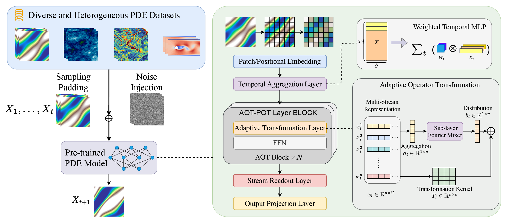

# 🌊 AOT-POT: Adaptive Operator Transformation for Large-Scale PDE Pre-training

<p align="center">
  <a href="https://nips.cc/virtual/2026/loc/sydney/poster/153792"></a>
  <a href="https://nips.cc/virtual/2026/loc/sydney/poster/153792"></a>
  <a href="#-installation"></a>
  <a href="#-installation"></a>
  <a href="#-installation"></a>
</p>

Official implementation of **[AOT-POT: Adaptive Operator Transformation for Large-Scale PDE Pre-training](https://nips.cc/virtual/2026/loc/sydney/poster/153792)**, accepted at **NeurIPS 2026**.

**Qitan Lv, Hong Wang, Zhongkai Hao, Wen Wu, Xuenan Xu, Bowen Zhou, Feng Wu, and Chao Zhang**

## ✨ Overview

AOT-POT learns adaptive, input-dependent transformations that make diverse PDE solution operators easier to model jointly. It expands latent features into parallel streams, adaptively aggregates and redistributes features around Fourier mixing layers, and mixes residual streams through doubly stochastic transformation matrices.

- 🧠 **Adaptive operator transformation:** reshape latent representations according to the input PDE.
- 🌍 **Multi-PDE pre-training:** learn from 12 datasets spanning fluid dynamics, shallow water, and diffusion-reaction systems.
- 🔄 **Transfer to downstream tasks:** fine-tune pretrained models on in-domain and out-of-domain PDEs.

<p align="center">
  
</p>

<p align="center"><em>Overview of AOT-POT. Adaptive operator transformations enable a single neural operator to learn across heterogeneous PDE datasets.</em></p>

## 🛠️ Installation

The reference environment uses **Python 3.9.25**, **PyTorch 2.4.0**, and the **CUDA 12.4** PyTorch runtime on Linux. Use NVIDIA GPUs with a driver compatible with CUDA 12.4. Create the `dpot` Conda environment and install the training dependencies:

```bash
conda create -n dpot python=3.9.25 pip -y
conda activate dpot
python -m pip install -r requirements.txt
```

[requirements.txt](requirements.txt) pins the training dependencies to the versions in the reference `dpot` environment, including the CUDA 12.4 build of PyTorch. Run the installation and training commands from the repository root with `dpot` activated.

## 📚 Datasets

Pre-training uses 12 datasets from four sources:

| Source | Included datasets | Download |
| --- | --- | --- |
| FNO | Three incompressible Navier-Stokes datasets | [Data](https://drive.google.com/drive/folders/1UnbQh2WWc6knEHbLn-ZaXrKUZhp7pjt-) |
| PDEBench | Four compressible Navier-Stokes datasets, shallow water, and diffusion-reaction | [Data](https://darus.uni-stuttgart.de/dataset.xhtml?persistentId=doi:10.18419/darus-2986) |
| PDEArena | Navier-Stokes and conditioned Navier-Stokes | [Data](https://microsoft.github.io/pdearena/datadownload/) |
| CFDBench | The preprocessed CFDBench mixture | [Data](https://cloud.tsinghua.edu.cn/d/435413b55dea434297d1/) |

The loader expects preprocessed HDF5 files containing a `data` array. Datasets can be stored in a single file with shape `(N, H, W, T, C)`, or in a directory of `data_<index>.hdf5` files with shape `(H, W, T, C)`. Single-channel samples may omit the channel dimension.

Set the root directory of your preprocessed datasets:

```bash
export DPOT_DATA_ROOT=/path/to/preprocessed/data/large
```

Register dataset paths, sample counts, and prediction horizons in [utils/make_master_file.py](utils/make_master_file.py). The `DPOT_DATA_ROOT` variable retains its original name for compatibility. Datasets and raw-data preprocessing scripts are not bundled with this release.

## 🚀 Pre-training

We provide four model configurations:

| Model | Configuration | Embedding dimension | MLP dimension | Layers | Fourier blocks |
| --- | --- | ---: | ---: | ---: | ---: |
| Tiny | [pretrain_tiny.yaml](configs/pretrain_tiny.yaml) | 512 | 512 | 4 | 4 |
| Small | [pretrain_s.yaml](configs/pretrain_s.yaml) | 1024 | 1024 | 6 | 8 |
| Medium | [pretrain_medium.yaml](configs/pretrain_medium.yaml) | 1024 | 4096 | 12 | 8 |
| Large | [pretrain_large.yaml](configs/pretrain_large.yaml) | 1536 | 6144 | 24 | 8 |

All four configurations use the same 12 datasets and sampling settings, train for **5001 epochs** on **8 GPUs**, and use 10 input timesteps to predict the next timestep at a spatial resolution of 128 × 128.

Choose one configuration to start pre-training:

```bash
# Tiny
python parallel_trainer.py --config_file pretrain_tiny.yaml

# Small
python parallel_trainer.py --config_file pretrain_s.yaml

# Medium
python parallel_trainer.py --config_file pretrain_medium.yaml

# Large
python parallel_trainer.py --config_file pretrain_large.yaml
```

The launcher selects available GPUs and uses Hugging Face Accelerate for distributed training. Adjust `num_gpus` and `device` in the configuration to match your hardware. The model dimensions above describe the supplied configuration files.

## 🎯 Fine-tuning

Edit [configs/dpot_finetune.yaml](configs/dpot_finetune.yaml) to set `resume_path` to your pretrained checkpoint, match the model architecture to that checkpoint, and select the target dataset in `tasks.train_paths`. The YAML anchor keeps `tasks.test_paths` aligned with the training dataset.

```bash
python trainer.py --config_file dpot_finetune.yaml
```

Each task runs on one GPU. The template uses **1001 epochs** and targets `ns2d_fno_1e-4`. Set `tasks.ntrain_list` to control the fine-tuning sample budget; otherwise, the dataset registry supplies the default count. For example, a single task using eight training samples can specify:

```yaml
tasks:
  # Add this field alongside the other task arguments.
  ntrain_list: [[8]]
```

Pretrained checkpoints are not bundled with this repository. Each checkpoint is expected to contain a `model` state dictionary.

## ⚙️ Configuration and outputs

Top-level YAML fields define shared arguments, while entries under `tasks` override them. Task lists are paired by index and must have equal lengths. For example, two learning rates and two batch sizes define two runs:

```yaml
tasks:
  lr: [0.001, 0.0001]
  batch_size: [64, 32]
```

Before launching, set a writable checkpoint directory in [train_temporal_parallel.py](train_temporal_parallel.py) and `log_base` in [finetune.py](finetune.py) for your environment.

With `use_writer: True`, training saves TensorBoard events, `logs.txt`, `params.json`, and model checkpoints. Both training scripts report per-dataset relative L2 validation errors.

## 🗂️ Code structure

```text
.
├── README.md
├── requirements.txt
├── parallel_trainer.py          # Multi-GPU pre-training launcher
├── train_temporal_parallel.py   # Pre-training and validation
├── trainer.py                   # Single-GPU task launcher
├── finetune.py                  # Fine-tuning and validation
├── configs/                     # Pre-training and fine-tuning configurations
├── models/                      # AOT-POT and supporting model implementations
├── utils/                       # Datasets, losses, optimizers, and utilities
├── torch_utils/                 # Persistence utilities
└── resources/
    └── model_figure.png         # Architecture overview
```

## 📝 Citation

If you find this work useful, please cite our paper:

```bibtex
@inproceedings{lv2026aotpot,
  title={{AOT-POT}: Adaptive Operator Transformation for Large-Scale PDE Pre-training},
  author={Lv, Qitan and Wang, Hong and Hao, Zhongkai and Wu, Wen and Xu, Xuenan and Zhou, Bowen and Wu, Feng and Zhang, Chao},
  booktitle={Advances in Neural Information Processing Systems},
  year={2026},
  url={https://nips.cc/virtual/2026/loc/sydney/poster/153792}
}

@article{lv2026aot,
  title={{AOT-POT}: Adaptive Operator Transformation for Large-Scale PDE Pre-training},
  author={Lv, Qitan and Wang, Hong and Hao, Zhongkai and Wu, Wen and Xu, Xuenan and Zhou, Bowen and Wu, Feng and Zhang, Chao},
  journal={arXiv preprint arXiv:2605.15793},
  year={2026}
}
```

## 🙏 Acknowledgments

Our implementation builds on [DPOT](https://arxiv.org/abs/2403.03542). We thank the DPOT authors for releasing their code and the FNO, PDEBench, PDEArena, and CFDBench teams for providing the datasets. Existing third-party copyright and license notices are retained in the source files.

```bibtex
@article{hao2024dpot,
  title={DPOT: Auto-Regressive Denoising Operator Transformer for Large-Scale PDE Pre-Training},
  author={Hao, Zhongkai and Su, Chang and Liu, Songming and Berner, Julius and Ying, Chengyang and Su, Hang and Anandkumar, Anima and Song, Jian and Zhu, Jun},
  journal={arXiv preprint arXiv:2403.03542},
  year={2024}
}
```
